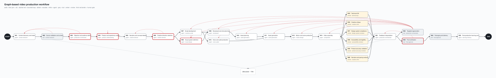

# Graph specification

> **TL;DR:** 25 nodes in 7 subgraphs. Flow edges form a DAG with join = all, bounded loop edges carry rework and
> rejections, and escalate edges stop the run. Each node is one of three kinds: agent, tool or review.
> Full field-level definitions: [node catalog](node-catalog.md) and [edge catalog](edge-catalog.md) (both generated).

Mermaid source: [graph.mmd](graph.mmd).

## Node kinds

| Kind | Who does the work | How it completes |
|---|---|---|
| `agent` | An agent from `agents/` (task packet) or a scripted fixture; a project command may follow (render, TTS, assembly). | Declared outputs are registered, the control-document check runs, then the completion checks. |
| `tool` | A deterministic function in `vpg/tools/`. | The same checks, with no agent involved. |
| `review` | Tool checks first (findings), then an agent scores the rubric's review dimensions. | A merged review record: tool MUST failures cannot be overridden, and every MUST dimension must be scored. |

A node may add `human_review.required`. After it validates, it waits in WAITING_HUMAN for `vpg approve`. The decision becomes the node's outcome (for example `approved`, `rejected` or `changes_requested`).

## Edge semantics

- **flow** — a forward dependency. A node is ready when **every** incoming flow edge is satisfied: the source is STEP_PASS and the source's outcome matches the edge's `when`.
- **loop** — a bounded back-edge (`max_traversals`). Every loop a result needs is checked against its bound first; if one has no traversal left, the node blocks and none fires. When it fires, it invalidates the target and its flow descendants. They re-run, or are memo-skipped when their fingerprint is unchanged. A loop edge never satisfies a join.
- **escalate** — goes to `@escalate`. The node becomes BLOCKED, the run becomes BLOCKED, and a report is written to `.vpg/escalations/`.
- **`when`** — `*` means any outcome; a label or an `a|b` list matches outcomes; `target:<node>` matches when the source's result lists that node in `targets` (targeted regeneration).
- **transition** — `deterministic` means the edge always fires on completion; `conditional` means it depends on the outcome. The validator checks that this label is consistent with `when`.

## Validation rules (`python -m vpg validate`)

1. Unique ids, nodes numbered 1–25 in brief order, and every edge endpoint known.
2. Flow edges are acyclic, with no duplicate flow edge between the same two nodes. Every loop edge has `max_traversals` ≥ 1 and goes upstream. Escalate edges target `@escalate`. `blocking_severities` starts at P1 and includes every more severe level.
3. Every node is reachable from START, and END is reachable from every node.
4. No dead-end outcome: every outcome has an outgoing edge. Every human-gate outcome is also a node outcome, so a human decision always fires an edge. A `target:` edge counts only for the regeneration node, which escalates at runtime when its plan has no target.
5. **Join deadlock safety:**
   - Any outcome of a join predecessor that does not satisfy the join must have a loop or escalate edge.
   - Deep joins, END included, are covered too. For every forward outcome, the successors it does not activate (and everything downstream of them) can never run. The activated part must loop back or finish before it reaches one of those.
6. **No control-document re-check cycle:**
   - When a node changes a control document, every node that reads it and is not upstream of the writer is re-checked, and so are that node's descendants.
   - The validator builds this relation between the control writers and rejects any cycle. An example is two unordered writers that each read the other's document; they would re-run each other with no loop edge to bound them.
   - Fix it by ordering the nodes in the flow, or by removing one of the reads.
7. Every node's 19 fields are non-empty. State paths exist in the typed model. Prompts, tools, schemas and rubrics resolve.
8. A MUST review dimension sits only on a review node, and a MUST human dimension only on a human-gated or review node, so no MUST criterion goes unscored.

Before it opens a run, the engine runs checks 1–6 and 8, plus the reference part of check 7 (state paths, prompts, tools, schemas, rubrics and control documents resolve). It refuses a graph that fails them. The documentation part of check 7 (every field filled in) is `vpg validate`'s alone.

At runtime:
- A run with nothing ready, nothing in flight and END not reached is BLOCKED with a `no-progress` report naming the waiting join; it is never left RUNNING.
- A chain of control-document re-checks longer than the number of control writers must revisit a writer, so the engine treats it as a cycle that slipped past check 6: the writer escalates.

## Subgraphs and patterns

| Subgraph | Nodes | Pattern |
|---|---|---|
| discovery | N01–N02 | Sequence, plus a bounded loop from gaps back to intake |
| definition | N03–N06 | Sequence with human gates |
| planning | N07, N09 → N08 → N10 | Fan-out (script ∥ visual system) then fan-in (storyboard) |
| production | N11 ∥ N12 → N13 → N14 | Map fan-out over assets, parallel voice, fan-in at motion |
| review | N15–N20 | Fan-out of six reviewers, fan-in at N21 |
| iteration | N21 → N22 | Tri-state gate, then a bounded targeted-rework loop to N07–N14 |
| delivery | N23 → N24 → N25 | Human release gate, package, governed learning |

## All 25 nodes

Generated from `graph/workflow.yaml`; `python -m vpg docs --check` fails if this table drifts.

<!-- NODES:START -->
| N | Node | Kind | Subgraph | Human gate | Gate hook | Loops back to |
|---|---|---|---|---|---|---|
| 01 | `n01_context_intake` — Context discovery and intake | agent | discovery | — | — | — |
| 02 | `n02_source_validation` — Source validation and context-gap detection | tool | discovery | — | freeze_inputs | n01_context_intake |
| 03 | `n03_objective_audience` — Objective and audience definition | agent | definition | yes | — | n01_context_intake |
| 04 | `n04_product_understanding` — Product and experience understanding | agent | definition | yes | — | n04_product_understanding |
| 05 | `n05_narrative_ideation` — Narrative and concept ideation | agent | definition | — | — | — |
| 06 | `n06_creative_direction` — Creative-direction selection | agent | definition | yes | — | n05_narrative_ideation |
| 07 | `n07_script_development` — Script development | agent | planning | — | — | — |
| 08 | `n08_storyboard_shots` — Storyboard and shot planning | agent | planning | — | — | — |
| 09 | `n09_visual_system` — Visual-system definition | agent | planning | yes | — | n09_visual_system |
| 10 | `n10_asset_planning` — Asset planning | agent | planning | — | — | — |
| 11 | `n11_asset_generation` — Asset generation | agent | production | — | — | — |
| 12 | `n12_voice_audio` — Voice and audio production | agent | production | — | — | — |
| 13 | `n13_motion_scenes` — Motion and scene production | agent | production | — | — | — |
| 14 | `n14_video_assembly` — Video assembly | agent | production | — | — | — |
| 15 | `n15_technical_qa` — Technical QA | review | review | — | — | — |
| 16 | `n16_creative_critique` — Creative critique | review | review | — | — | — |
| 17 | `n17_design_compliance` — Design-system compliance | review | review | — | — | — |
| 18 | `n18_accessibility_legibility` — Accessibility and legibility validation | review | review | — | — | — |
| 19 | `n19_product_accuracy` — Product-accuracy validation | review | review | — | — | — |
| 20 | `n20_narrative_pacing` — Narrative and pacing evaluation | review | review | — | — | — |
| 21 | `n21_feedback_interpretation` — Feedback interpretation | agent | iteration | — | review_gate | — |
| 22 | `n22_targeted_regeneration` — Targeted regeneration | tool | iteration | — | regeneration_plan | n07_script_development, n08_storyboard_shots, n09_visual_system, n10_asset_planning, n11_asset_generation, n12_voice_audio, n13_motion_scenes, n14_video_assembly |
| 23 | `n23_final_verification` — Final verification | tool | delivery | yes | — | n21_feedback_interpretation |
| 24 | `n24_packaging_delivery` — Packaging and delivery | tool | delivery | — | package | — |
| 25 | `n25_learning_memory` — Post-production learning and memory updates | agent | delivery | — | — | — |
<!-- NODES:END -->

## Policies (`policies:` in workflow.yaml)

- `max_rework_cycles` 6.
- `max_same_defect_failures` 3.
- `parallel_limit` 6.
- Single-flight resources: `tts`, `renderer`, `capture`, `image-api`.
- `blocking_severities` P1–P3: nits never block; everything else does.
